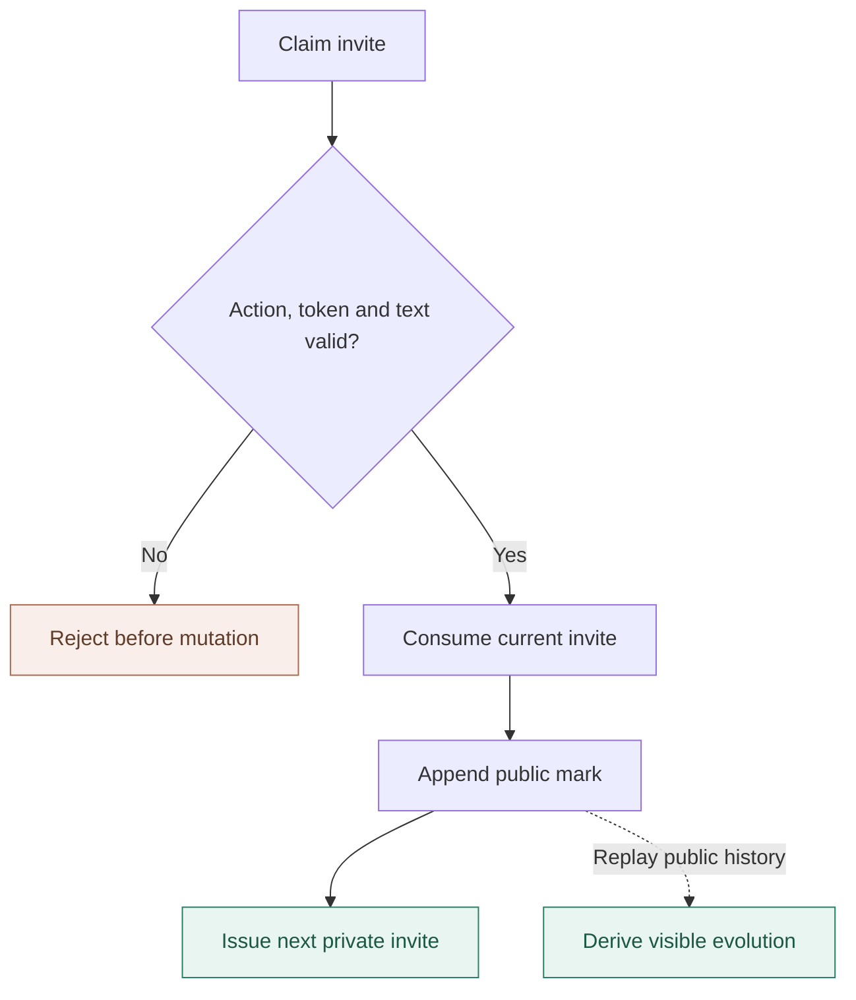

# Relic Zero

The idea is a little strange: a person gets a secret invite, makes one public mark on a shared relic, and hands the next invite to somebody else.

The relic is a panda, because apparently I needed one more project that was difficult to explain in a single sentence.

Under the panda is a one-use capability chain written in JavaScript. This public version focuses on the rules, not the art or the interface.

## What actually happens

A claim has an action (`bless` or `corrupt`), an invite token, a name, and a message. The relay validates **everything before touching the state**. Wrong token? Replay? Bad action? Invalid text? No mutation.

For a valid claim, it:

1. Consumes the current invitation.
2. Appends a bounded public history entry.
3. Derives the next private invite with HMAC and stores its hash.
4. Returns the next invite for manual handoff.

The plain invite never goes into public history. `evolution()` replays that history to derive visible state; there isn't a second counter quietly drifting out of sync.

## The panda has a strict guest list

No valid token gets used twice, and the next token never goes into the public history. The panda takes this more seriously than its job description suggests.

Node.js 20+. Go to [relay.js](src/relay.js) for the sequence, [tokens.js](src/tokens.js) for hashing/derivation, [evolution.js](src/evolution.js) for replay, and [tests](test/) for one-use behavior.

**Not an audited security system.** This is an in-memory proof of the relay rules. A real public game would need durable atomic state, concurrency handling, rate limits, moderation, and secret management. The panda cannot do those jobs. [Security boundaries](SECURITY.md) · [verification](docs/verification.md).
